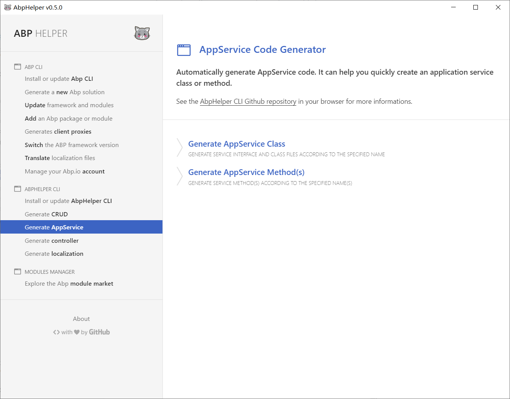
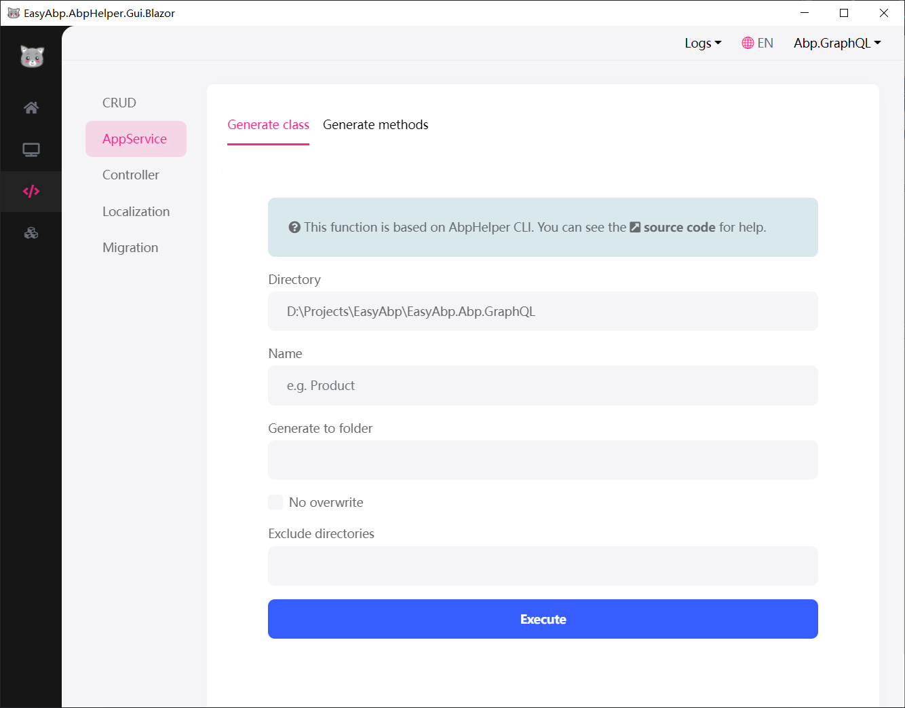
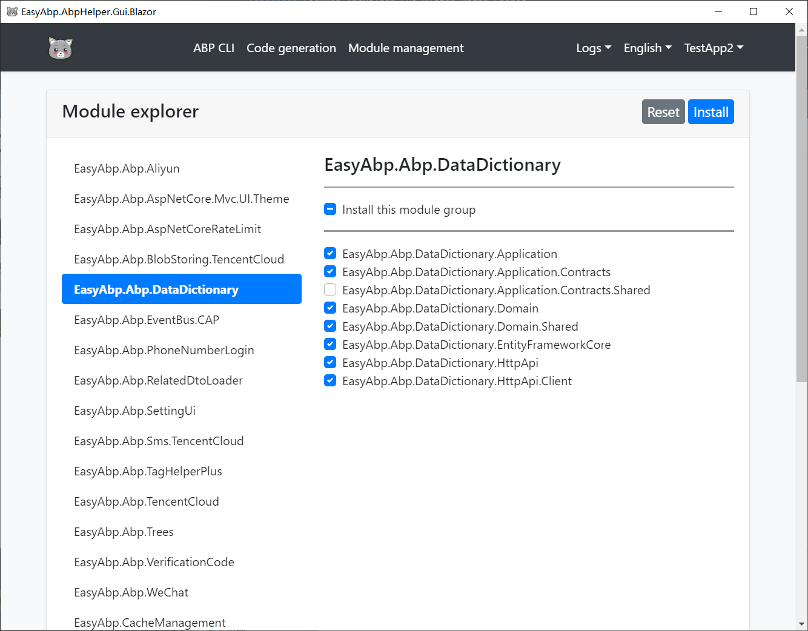
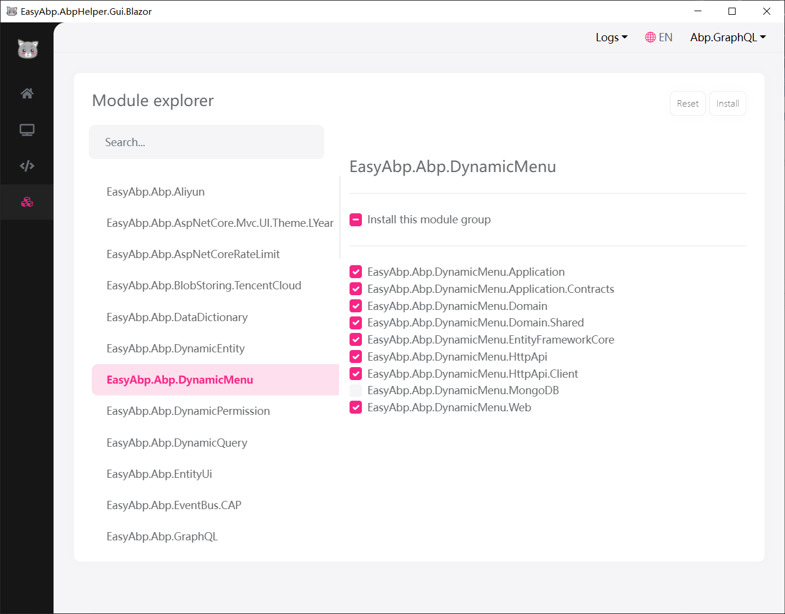

# AbpHelper.GUI

> [!WARNING]
> **This project is no longer maintained, and the repository is archived.**
> The last release is [2.20.0](https://github.com/EasyAbp/AbpHelper.GUI/releases/tag/2.20.0). It is not updated for ABP 11 or later.
> To create solutions and add modules, use [ABP Studio](https://abp.io/studio). To scaffold entities, CRUD code and other features, a coding agent working in your solution now does what this tool did, following your project's own conventions.

Providing code generation and more features to help you develop applications and modules with the [ABP framework](https://abp.io). It can be used to call ABP CLI, generate code, manage modules, etc.

**Make sure backup your source files before using it!**

## Getting Started

1. Clone this Git repository with submodules. You can try `git clone --recurse-submodules https://github.com/EasyAbp/AbpHelper.GUI.git`.

2. Run the `bash ./run.sh` command or the run.ps1 script file to start the AbpHelper GUI.

## Usage

* [Generate CRUD Code](/docs/AbpHelper-CLI/Generate-CRUD-Code/Usage.md)

## Roadmap

- [x] AbpHelper CLI update check
- [x] Remember recent solutions
- [x] Module management
- [x] Localization support
